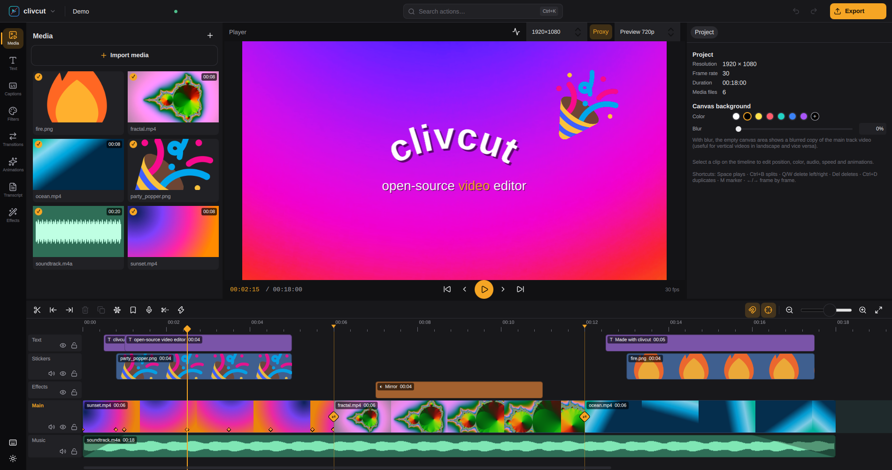
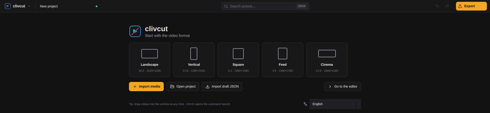
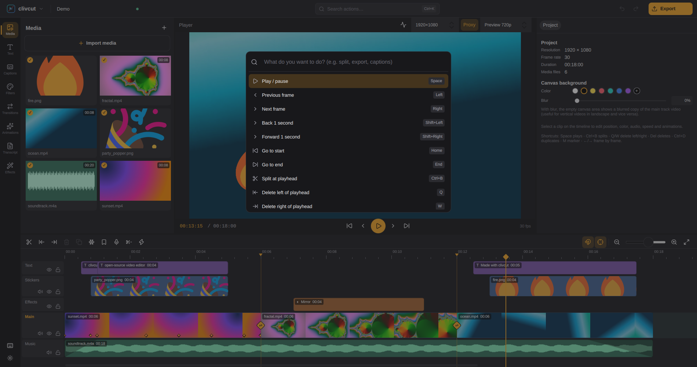
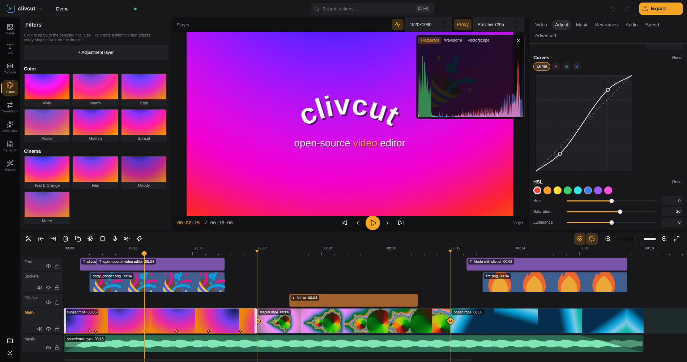
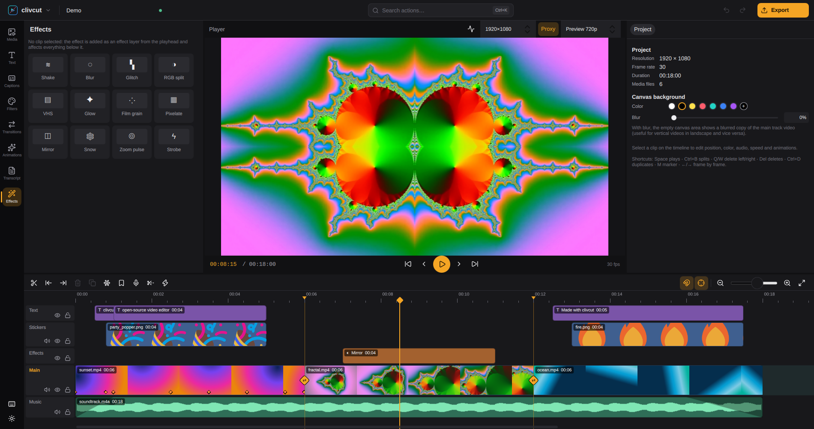
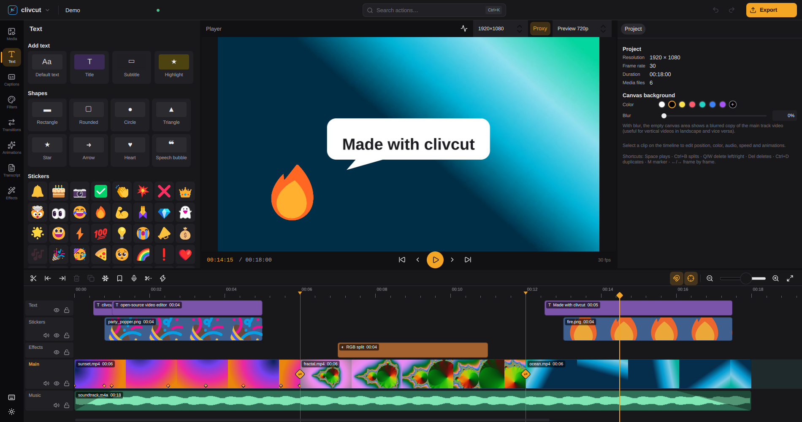
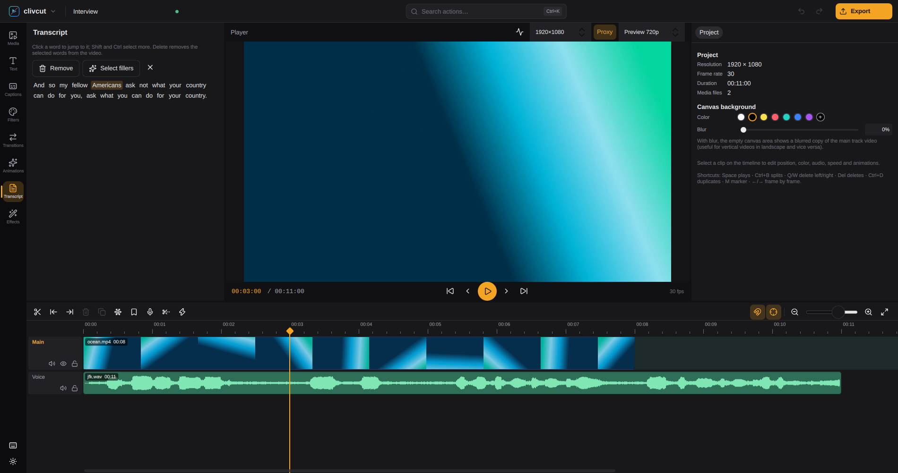
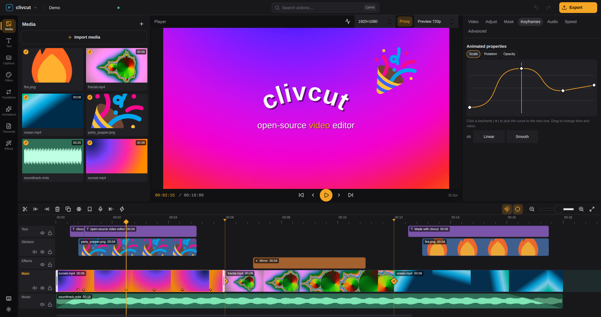
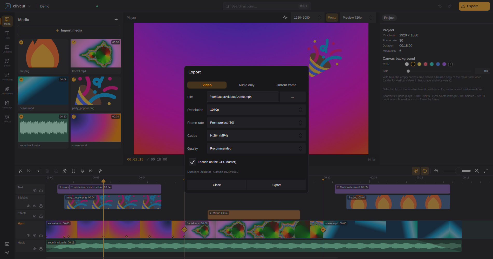

# clivcut

An **open-source, cross-platform** video editor (Linux first), built around a fast editing flow: magnetic main track, quick cuts, text, transitions, animations, keyframes and one-click export.

Written in **C++20 + Qt 6 (Qt Quick / RHI) + FFmpeg**. Video compositing runs on the GPU (Vulkan, OpenGL, Metal or Direct3D, via Qt RHI). Preview and export share **the same compositor**, so the exported file matches what you see in the player.



| | |
|---|---|
|  |  |
| Start from a canvas format, open a project or import a draft JSON. | **Command palette** (Ctrl+K): every action, searchable, with its shortcut. |
|  |  |
| **Color grading:** filters, tone curves, HSL and color wheels, with live scopes. | **Video effects** on clips or as effect layers over everything below. |
|  |  |
| **Text, shapes and stickers:** speech bubbles, curved text, highlighted words. | **Edit by transcript:** select words (or filler words) and remove them from the video. |
|  |  |
| **Keyframe graph editor** with per-segment easing and custom Bézier curves. | **Export** on the GPU, with transparent video, audio-only and still-frame modes. |

## Features

- **Media:** imports video, audio and images (anything FFmpeg can read) via drag and drop or the file dialog. Thumbnails, waveforms, missing-media relinking, and correct rotation for phone videos.
- **Performance:**
  - **Hardware decoding:** VA-API on Linux, D3D11VA on Windows and VideoToolbox on macOS, with GPU downscaling.
  - **Render preview** (Ctrl+R): pre-renders the in/out range or the whole timeline so heavy sections play smoothly. Rendered parts show as a green bar on the ruler, and an edit only invalidates the parts it touches.
  - **Automatic proxies** for videos above 1080p, generated in the background. The player's "Proxy" button toggles between proxy and original; export always uses the original.
- **Timeline:**
  - Free clip placement on the main track (gaps allowed), with an optional magnet that keeps it gap-free, plus overlay, text and audio tracks, with mute, hide and lock.
  - Split (Ctrl+B), delete left/right of the playhead (Q/W), trim, move between tracks and ripple delete.
  - Snapping, zoom, markers, duplicate and freeze frame.
  - **Copy, cut and paste** clips, including across projects via the system clipboard, carrying the media along.
  - **Copy and paste attributes**, **group** clips, **rubber-band selection** and moving several clips at once.
  - **Compound clips** (Alt+G): combine clips from several tracks into one clip, then move, trim, split, transform, color-grade, mask or add effects and transitions to the whole group. Double-click (or Alt+E) opens its contents in the timeline for editing, with its own undo history; Back (Alt+↑) returns, and the whole edit becomes one undo step. Alt+Shift+G breaks it apart again at the same timing.
  - Right-click context menu on clips.
- **Transform:** position, scale, rotation, opacity, flip and crop. Drag to move in the player; Ctrl+wheel resizes.
- **Keyframes:**
  - On position, scale, rotation, opacity, volume, brightness, contrast and saturation, via the ◆ button next to each property.
  - **Graph editor** in the Keyframes tab: drag time and value and pick the curve for each segment (linear, ease in, ease out, smooth, hold or **custom Bézier** with handles).
- **Text:** font, size, color, outline, shadow, background box and alignment, curved text, and words between *asterisks* in a highlight color. Title, subtitle and highlight presets.
- **Shapes:** rectangle, rounded, circle, triangle, star, arrow, heart and speech bubble, with fill color and size, alone or behind text.
- **Stickers:** a built-in library of 47 emoji stickers ([Fluent Emoji](https://github.com/microsoft/fluentui-emoji), MIT license), added as transparent images above the main track.
- **Transitions:** dissolve, dip to black, wipes and slides in four directions, circle, zoom in and out, spin, white flash, glitch and blur.
- **Video effects** (Alt+8): shake, blur, glitch, RGB split, VHS, glow, film grain, pixelate, mirror, snow, zoom pulse and strobe, with intensity, on a clip or as an effect layer over everything below.
- **In and out animations:** fade, zoom and slide.
- **Color:**
  - 16 built-in filters (Vivid, Teal & Orange, Vintage, Noir…), previewed on the current frame, with intensity.
  - `.cube` LUTs with intensity.
  - Exposure, brightness, contrast, saturation, highlights, shadows, temperature, tint, vignette and sharpness.
  - **Scopes** over the player (Ctrl+Shift+V): histogram, luma waveform and vectorscope with color targets and a skin tone line, measured on the composited frame.
  - **Advanced grading:** tone curves (luma, R, G, B), HSL per color range (8 ranges) and lift/gamma/gain color wheels, baked into a LUT on the GPU.
  - **Adjustment/filter layers** on the timeline that affect everything below them.
- **Compositing:**
  - 10 blend modes and chroma key.
  - Linear, mirror, circle and rounded-rectangle **masks**, with position, size, rotation, feather and invert. They also work on adjustment layers, to grade just one region.
- **Edit by transcript** (Alt+7): transcribes the timeline word by word, locally. Click a word to jump to it; delete words (or select the fillers like "um" and "uh") to cut those parts of the video with ripple.
- **Remove silences** (Ctrl+Shift+R): finds the pauses in what you hear, marks them in red on the ruler for review and cuts them all with ripple, keeping a short margin around each phrase.
- **Speed:**
  - Constant from 0.1× to 10×, and reverse (audio included). The pitch is kept by default and can be unlocked per clip.
  - **Speed curves** (Montage, Hero, Bullet, Jump…), with a point-based graph editor. Speed curves from drafts are imported too.
- **Audio:**
  - Volume (up to 200%), gain in dB, fade in/out and multi-track mixing.
  - **Loudness normalization** (EBU R128) for social media (-14 LUFS), podcast (-16) or broadcast (-23).
  - Local **noise reduction**, processed in the background and kept in sync with the video.
  - **Voiceover recording** (Alt+R): counts down, records the microphone while the timeline plays from the playhead and drops the take on an audio track at that point.
  - **Voice effects:** echo, hall reverb, robot, high pitch, deep voice, telephone and old radio, processed in the background and kept in sync.
  - **Ducking:** background music gets quieter automatically while there is speech on the other clips.
  - **Beat detection:** finds the tempo of a music clip and adds beat markers (every beat, every 2 beats or every bar); clips snap to them, so cuts land on the beat.
  - **AI voice isolation** (DeepFilterNet3, local): keeps only the speech, removing music, noise and room sound. The model (16 MB) is downloaded once.
  - **Detach audio from video** (Ctrl+Shift+D) and mute clip.
- **Background removal:** cuts people out of videos without a green screen, using a local AI model (RobustVideoMatting on ONNX Runtime, downloaded once). Processing runs in the background and the result is used in preview and export.
- **Canvas:** 16:9, 9:16, 1:1, 4:3, 3:4, 4:5 and 21:9, with a background color or a blurred copy of the main video.
- **Export:**
  - H.264, HEVC, AV1 and ProRes 422 HQ codecs, depending on the installed FFmpeg.
  - **GPU encoding** (VA-API, NVENC, Quick Sync, VideoToolbox, AMF) when the driver supports it, with automatic fallback to software.
  - **Transparent video:** ProRes 4444 (MOV) and VP9 (WebM) keep the alpha channel; areas without clips stay transparent.
  - **Audio only** (WAV, FLAC, AAC, Opus, MP3) and the **current frame** as PNG/JPG.
  - 480p to 4K, 24 to 60 fps, with AAC audio; optionally only the in/out range.
- **Fully local automatic captions** with whisper.cpp, no cloud:
  - 90+ languages, with models downloaded on demand (Tiny to Large v3 Turbo).
  - Each caption becomes an editable text clip on a "Captions" track.
  - "Apply to all" copies one caption's style to the whole track.
  - SRT/VTT import and SRT export.
- **Draft import** (`draft_content.json` / `draft_info.json`, unencrypted):
  - Brings in media, cuts, speed, volume, transforms and position, scale, rotation, opacity and volume keyframes.
  - Also brings in text, fades and transitions.
- Unlimited **undo/redo**, with continuous edits merged.
- **Recovery:**
  - Automatic backup every 30 s while there are unsaved changes.
  - Offers to recover your work after an unexpected shutdown.
  - Asks before discarding changes.
- **Languages:** English, Português (Brasil) and Español. The interface follows the system language and can be switched live from the logo menu, the command palette or the welcome screen.
- **`clivcut-render`:** headless rendering, conversion and transcription (`--transcribe`) from the command line.

See the [roadmap](docs/ROADMAP.md) for what comes next: interactive cutout, stem separation and more.

## Building

Dependencies:
- CMake ≥ 3.24 and a C++20 compiler (GCC 12+ or Clang 15+);
- Qt ≥ 6.7: Core, Gui (with private headers for RHI), Quick, QuickControls2, ShaderTools, Concurrent and Test;
- FFmpeg ≥ 6 (libavformat, libavcodec, libswscale, libswresample, libavfilter);
- SDL2;
- whisper.cpp: optional. Downloaded and built automatically by CMake (`-DCLIVCUT_WITH_WHISPER=OFF` disables it; `-DCLIVCUT_WHISPER_VULKAN=ON` enables GPU acceleration).

```sh
# Debian/Ubuntu (24.04+)
sudo apt install cmake ninja-build g++ qt6-base-dev qt6-base-private-dev qt6-declarative-dev \
    qt6-shadertools-dev libavformat-dev libavcodec-dev libswscale-dev libswresample-dev \
    libavfilter-dev libsdl2-dev ffmpeg
# Fedora
sudo dnf install cmake ninja-build gcc-c++ qt6-qtbase-devel qt6-qtbase-private-devel \
    qt6-qtdeclarative-devel qt6-qtshadertools-devel ffmpeg-devel SDL2-devel
# Gentoo
emerge dev-qt/qtbase dev-qt/qtdeclarative dev-qt/qtshadertools media-video/ffmpeg media-libs/libsdl2

cmake -S . -B build -G Ninja -DCMAKE_BUILD_TYPE=Release
cmake --build build
ctest --test-dir build          # tests (core, media, GPU, controller)
```

## Packages

**AppImage** (a single file that runs on most distros):

```sh
packaging/appimage/build-appimage.sh      # produces dist/clivcut-<version>-x86_64.AppImage
chmod +x dist/clivcut-*.AppImage && dist/clivcut-*.AppImage
```

**Flatpak** (manifest in `packaging/flatpak/`; builds FFmpeg with x264, VA-API and whisper.cpp inside the sandbox):

```sh
flatpak install flathub org.kde.Sdk//6.11 org.kde.Platform//6.11
flatpak-builder --user --install --force-clean build-flatpak packaging/flatpak/io.github.clivcut.yml
flatpak run io.github.clivcut
```

`cmake --install build` installs the binaries, the `.desktop` file, the icon and the AppStream metainfo.

**Windows** (MSVC 2022 + [vcpkg](https://vcpkg.io)):

```powershell
vcpkg install --triplet x64-windows "ffmpeg[core,avcodec,avformat,avfilter,swscale,swresample,gpl,x264,dav1d,opus]" sdl2
cmake -S . -B build -G Ninja -DCMAKE_BUILD_TYPE=Release -DCMAKE_PREFIX_PATH=C:\Qt\6.8.3\msvc2022_64 `
      -DCMAKE_TOOLCHAIN_FILE=%VCPKG_ROOT%\scripts\buildsystems\vcpkg.cmake
cmake --build build
cd build && cpack -G NSIS      # clivcut-<version>-win64.exe installer (Qt and DLLs bundled)
```

**macOS** (`.dmg` for Intel and Apple Silicon, built in Docker):

```sh
make dmg        # dist/clivcut-<version>-macos-<arch>.dmg for this Mac (x86_64 or arm64)
make dmg-all    # both architectures
make help       # other targets (builder image, DMG art preview, cleanup)
```

Only Docker is needed on the host. The builder (`packaging/macos/Dockerfile`) cross-compiles for macOS on Linux: osxcross (clang + Apple's ld64) against the SDK exported from this Mac's Command Line Tools (`make macos-sdk`, kept in `.cache/`), the official Qt binaries, and FFmpeg, codecs and SDL2 built for each architecture. `packaging/macos/bundle.py` makes the `.app` self-contained (Qt, plugins, QML, FFmpeg, ONNX Runtime) with an ad hoc signature, and `packaging/macos/dmg.py` writes the drag-to-Applications installer. The first `make dmg` takes about 40 minutes (image build); later runs reuse the image and the incremental build. The app is not notarized: a DMG downloaded from the internet must be opened once with right-click → Open.

For development, a native build with Homebrew also works:

```sh
brew install ninja pkg-config ffmpeg sdl2 qt
cmake -S . -B build -G Ninja -DCMAKE_BUILD_TYPE=Release -DCMAKE_PREFIX_PATH="$(brew --prefix qt)"
cmake --build build
```

On Intel, ONNX Runtime is pinned to 1.23.2, the last official `osx-x86_64` build (set `CLIVCUT_ONNXRUNTIME_ROOT` to use another one, or `-DCLIVCUT_WITH_ONNX=OFF` to build without local AI). Homebrew no longer ships bottles for Intel Macs, so there `brew install qt` compiles Qt from source; prefer `make dmg`.

On Windows the GPU path uses Direct3D 11 and on macOS Metal, with the same shaders. CI (`.github/workflows/build.yml`) builds the AppImage, the Windows installer and the macOS DMGs (Intel and Apple Silicon) on every push.

## Usage

```sh
build/src/app/clivcut                         # GUI
build/src/app/clivcut video1.mp4 music.mp3    # open and import media right away
build/src/app/clivcut ~/path/to/draft         # open a draft JSON folder

# Command line
build/src/cli/clivcut-render project.clivcut out.mp4 --codec hevc --height 2160
build/src/cli/clivcut-render ~/draft_folder out.mp4             # render a draft JSON
build/src/cli/clivcut-render --convert ~/draft_folder project.clivcut
build/src/cli/clivcut-render --probe video.mp4
build/src/cli/clivcut-render --transcribe --model small --language pt video.mp4 captions.srt
build/src/cli/clivcut-render --bench video_4k.mp4            # benchmark decoding (--no-hw compares with software)
```

Transcription models live in `~/.local/share/clivcut/models` (`~/Library/Application Support/clivcut/models` on macOS). Set `CLIVCUT_MODELS_DIR` to change the location. Download them from the app's **Captions** tab or manually:
`curl -L -o ~/.local/share/clivcut/models/ggml-small.bin https://huggingface.co/ggerganov/whisper.cpp/resolve/main/ggml-small.bin`

Useful environment variables:
- `CLIVCUT_RHI=vulkan|opengl` selects the export backend.
- `QSG_RHI_BACKEND=vulkan|opengl` selects the UI backend.
- `CLIVCUT_HWDEC=0` disables hardware decoding.
- `CLIVCUT_CACHE_DIR` changes the cache folder (proxies), `~/.cache/clivcut` by default.
- `CLIVCUT_FFMPEG_LOG=1` shows all FFmpeg logs.

### Shortcuts

Every shortcut can be changed in **Keyboard shortcuts** (keyboard button at the bottom of the left rail, or the command palette). These are the defaults:

| Action | Key |
|---|---|
| Play/pause | Space |
| Split | Ctrl+B |
| Delete left/right of the playhead | Q / W |
| Delete (ripple) | Del (Shift+Del) |
| Undo/redo | Ctrl+Z / Ctrl+Shift+Z |
| Duplicate | Ctrl+D |
| Copy / cut / paste | Ctrl+C / Ctrl+X / Ctrl+V |
| Copy / paste attributes | Ctrl+Alt+C / Ctrl+Alt+V |
| Group / ungroup | Ctrl+G / Ctrl+Shift+G |
| Create / break compound clip | Alt+G / Alt+Shift+G |
| Edit compound clip / back | double-click or Alt+E / Alt+↑ |
| Select all | Ctrl+A |
| Rubber-band selection | drag on empty timeline space (Ctrl/Shift adds) |
| Previous/next frame (1 s with Shift) | ← / → |
| Start/end | Home / End |
| Marker | M |
| Mark in / out, clear, go to in / out | I / O, Alt+X, Shift+I / Shift+O |
| Freeze frame | Alt+F |
| New text | Ctrl+T |
| Toggle snapping | N |
| Timeline zoom / fit | Ctrl+= / Ctrl+− / Shift+Z |
| Import / Export / Save | Ctrl+I / Ctrl+E / Ctrl+S |

## Architecture

Overview in [docs/ARCHITECTURE.md](docs/ARCHITECTURE.md).

```
src/core    model, editing, keyframes, history, per-frame evaluation, draft JSON importer (QtCore only)
src/media   FFmpeg: probe, frame-accurate seeking decode, 48 kHz audio, encoder
src/render  Qt RHI compositor + GLSL shaders, text rasterization
src/engine  audio mixer, frame source, exporter
src/app     Qt Quick (QML) UI, GPU preview, SDL2 audio output
src/cli     clivcut-render
tests       QtTest
```

## License

GPL-3.0-or-later. See [LICENSE](LICENSE).
